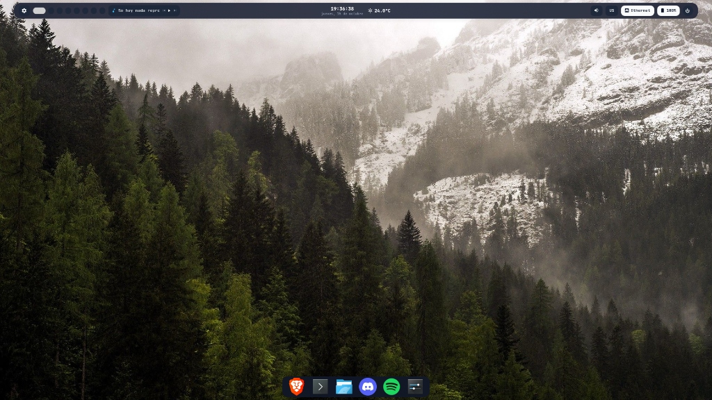

<div align="center">

# 🐍 Serpanplasma

**Exact visual and functional clone of *Serpantinum* adapted 100% for KDE Plasma 6 (Wayland) with traditional floating window management.**

[🇪🇸 Español](README.md) | [🇬🇧 English](README_EN.md)

[](https://kde.org/plasma-desktop/)
[](https://wayland.freedesktop.org/)
[](https://cachyos.org/)
[](https://github.com/jorjanion/Serpanplasma)
[](LICENSE)

<br/>



</div>

---

## 📖 Overview

**Serpanplasma** is a pixel-perfect recreation of the clean, minimalist visual experience of **[Serpantinum](https://github.com/ilyamiro/serpantinum)** (ilyamiro's Quickshell desktop shell), engineered natively for **KDE Plasma 6 over Wayland**.

It delivers Serpantinum's aesthetics without tiling window managers (like Hyprland or Niri), preserving the comfort, stability, and intuitive workflow of traditional Windows floating window management.

---

## 🎯 Key Highlights

- ❌ **No Forced Tiling:** No complex keybinding gymnastics or auto-splitting windows across your screen.
- ✅ **True Floating Windows (Windows Style):** Applications open centered with comfortable default sizing, drag-and-drop freely, overlap naturally, and include classic window buttons (**_**, **□**, **X**).
- ✅ **Standard Windows Shortcuts:**
  - `Alt + F4`: Close active window.
  - `Alt + Tab`: Switch between running applications.
  - `Win + Up Arrow`: Maximize active window.
  - `Win + Down Arrow`: Restore or minimize active window.
  - `Win + E`: Launch Dolphin file manager.
- ✅ **Floating Top Bar with Native Pills:** Translucent floating top panel with rounded corners, native KWin blur, and capsules identical to Serpantinum.
- ✅ **Floating Application Dock:** Centered floating bottom dock with task indicators for your favorite apps.
- ✅ **Interactive 1:1 Settings & Guide Dashboard:** Standalone Qt6/QML guide with a Welcome screen, comprehensive dock settings, bar configurations, theme selectors, and system toggles.
- ✅ **Universal Compatibility:** Tailored for any Linux distribution running KDE Plasma 6 (CachyOS, Arch Linux, Fedora, openSUSE, Debian, etc.) and fully verified on hybrid graphics (AMD + NVIDIA 144Hz).

---

## 💎 Design Anatomy (1:1 Serpantinum Replica)

```
┌────────────────────────────────────────────────────────────────────────────────────────────────────────┐
│  [⚙]  [ ━ ] ● ● ● ● ● ● ●  [ ♫ Track Title ⏮ ▶ ⏭ ]        19:36:38       󰖙 24.0°C      [󰕾] [US] [󰈀 Ethernet] [󰁹 100%] [⏻]  │
│                                                     jueves, 15 de octubre                                     │
└────────────────────────────────────────────────────────────────────────────────────────────────────────┘
```

### 1. Floating Top Bar (`org.serpanplasma.bar`)
- **Left Section:**
  - `[ ⚙ ]`: Rounded square button that opens and toggles the **Serpanplasma Settings & Guide** window.
  - `[ ━ ] ● ● ● ● ● ● ●`: Workspaces module (`PillsFace`) featuring an expanded mauve/lavender pill (`#d0d0d0`) for the active workspace and 7 circular dots (`#1e293b`) for inactive desktops, with smooth animations and click-to-switch.
  - `[ ♪ Title - Artist ⏮ ▶ ⏭ ]`: Media capsule displaying the currently playing track or *"No hay nada reprc"*, with interactive MPRIS playback controls (previous, play/pause, next).
- **Center Section:**
  - **Stacked Digital Clock:**
    - Line 1: Exact time in `HH:mm:ss` format using **JetBrains Mono Nerd Font** in heavy Black weight.
    - Line 2: Full date localized in Spanish (`dddd, d 'de' MMMM`) in subtle slate grey (`#94a3b8`).
  - **Live Weather Capsule:** Real-time weather condition icon (`☁`, `󰖙`, `󰖖`, etc.) and temperature in Celsius fetched from Open-Meteo.
- **Right Section:**
  - `[ 󰕾 ]`: Interactive volume control with mouse scroll support (volume up/down) and click-to-mute.
  - `[ US / EN ]`: Current keyboard layout indicator.
  - `[ 󰤨 Connected ]` / `[ 󰈀 Ethernet ]`: **Solid crisp white capsule (`#f8fafc`)** with high-contrast dark text and icon (`#0f172a`), indicating network status and SSID.
  - `[ 󰁹 100% ]`: **Solid crisp white capsule (`#f8fafc`)** with dynamic battery/charging icon and percentage.
  - `[ ⏻ ]`: Circular power button triggering Plasma's logout and shutdown dialogue.

### 2. Centered Floating Application Dock
- Floating panel detached from the bottom screen edge.
- Pinned launchers for Terminal (`kitty`/`konsole`), File Manager (`dolphin`), Web Browser, `Discord`, `Spotify`, and System Settings.
- Smart running indicators and drag-and-drop pinning support.

### 3. Settings & Guide Dashboard (`serpanplasma-settings`)
- Exact recreation of Serpantinum's `GuidePopup.qml` & `WelcomeTab.qml`:
  - **Welcome Tab:** Hero banner, version badge `v1.0.0`, feature cards, and quick navigation shortcuts.
  - **Top Bar Tab:** Height sliders (32px - 48px), module visibility toggles, and instant reload button.
  - **Dock Tab:** Comprehensive settings matching the original (position, element size, autohide, smart autohide, hover scale, running indicators, pinned apps).
  - **Theme Tab:** Obsidian palette (official), Catppuccin Mocha, and Breeze Dark with live color chips and font info.
  - **Windows Tab:** KWin floating rules, click-to-raise, 12px rounded corners, 35% shadow, and shortcut overview.
  - **Wallpapers Tab:** Slideshow intervals and instant next wallpaper switch for `~/Imágenes/Wallpapers/`.
  - **System & About:** Hardware compositor metrics and GitHub project links.

---

## 🛠️ Architecture

```
Serpanplasma/
├── assets/                          # Visual resources and desktop previews
├── configs/
│   ├── applications/                # Desktop entry for Serpanplasma Settings
│   ├── autostart/                   # Autostart entry for the status daemon
│   ├── bin/                         # CLI launcher (serpanplasma-settings)
│   ├── guide/                       # Standalone Settings & Guide QML application
│   ├── systemd/                     # Systemd user service for background daemon
│   └── terminal/                    # Profiles for Konsole, Kitty, and Alacritty
├── fonts/                           # JetBrains Mono Nerd Font typography
├── scripts/
│   ├── setup-panel.js               # Plasma scripting layout for bar and dock
│   ├── setup-wallpapers.js          # Wallpaper slideshow configuration
│   └── status-daemon.py             # Ultra-lightweight local HTTP status daemon (<1ms)
├── themes/
│   ├── color-schemes/               # Obsidian color scheme for KDE Plasma
│   ├── plasma/
│   │   ├── desktoptheme/            # Serpanplasma desktop theme (Blur, SVGs)
│   │   └── plasmoids/
│   │       └── org.serpanplasma.bar # Native QML top bar plasmoid
│   └── window-decorations/          # Breeze configuration with rounded corners
├── install.sh                       # Automated installer with backups
├── restore.sh                       # Restoration script to revert changes
├── README.md                        # Documentation in Spanish
└── README_EN.md                     # Documentation in English
```

---

## 🚀 Installation

### Prerequisites:
- OS: CachyOS, Arch Linux, or any distribution running **KDE Plasma 6 (Wayland)**.
- Packages: `git`, `python3`, `curl`, `jq`, `playerctl`.

On Arch Linux / CachyOS:
```bash
sudo pacman -S --needed git python jq playerctl
```

### Clone and Install:
```bash
git clone https://github.com/jorjanion/Serpanplasma.git
cd Serpanplasma
chmod +x install.sh restore.sh
./install.sh
```

The installer will:
1. Create a full backup in `~/.config/serpanplasma-backup/`.
2. Install and register **JetBrains Mono Nerd Font**.
3. Apply the **Serpanplasma Obsidian** color palette.
4. Deploy the native **Serpanplasma Bar** plasmoid and floating application dock.
5. Install and enable the background status daemon via `systemd --user`.
6. Deploy the **Settings & Guide** application and link the `[ ⚙ ]` top bar button.
7. Configure KWin for centered floating placement, click-to-raise, and Windows shortcuts.

---

## 🔄 Restoration / Uninstallation

To revert your desktop to its exact previous state:
```bash
cd Serpanplasma
./restore.sh
```
This stops the daemon, removes the custom plasmoid and settings files, and restores your previous KDE configuration files from the backup.

---

## 📄 License

Distributed under the **GPL-3.0-or-later** license. See [LICENSE](LICENSE) for details.
Inspired by the visual design of [Serpantinum](https://github.com/ilyamiro/serpantinum) by ilyamiro.
